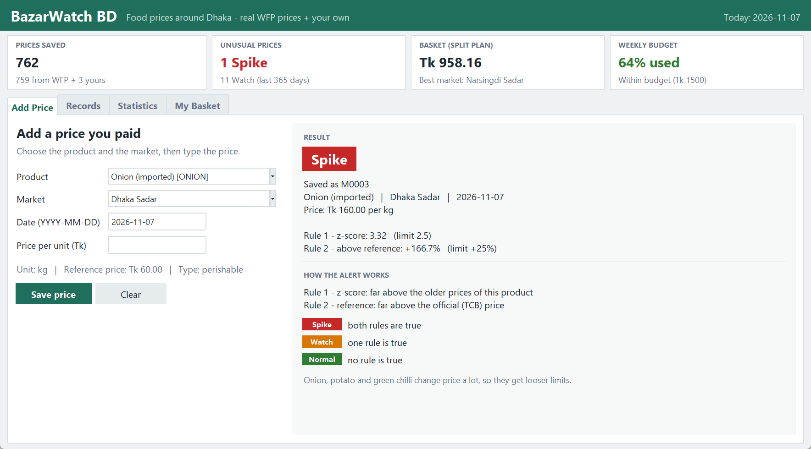

# BazarWatch BD

A small desktop app that helps a family in the Dhaka area keep an eye on
food prices. You write down what you paid at the bazar, and the app tells
you if the price looks normal or too high, which market is cheapest, and
whether your weekly shopping fits your budget.

It mixes two kinds of prices:

- **Real prices** from the World Food Programme (WFP) for 4 markets near Dhaka,
  January 2024 to August 2026 (759 records). These are read only.
- **Your own prices**, which you can add, edit and delete in the app.

Made for the CSC 4162 Programming in Python mid-term project.
The interface uses Tkinter and the maths uses NumPy.



## Features

| Tab | What you can do |
|-----|-----------------|
| Add Price | Add a price you paid. The app checks it right away and shows **Normal**, **Watch** or **Spike**. |
| Records | See all prices, search by product, market, date or ID, filter by product, edit or delete your own prices. |
| Statistics | Count, mean, median, min, max and standard deviation per product, the cheapest market, all Watch/Spike prices, set a reference price, save a `.txt` report. |
| My Basket | Make a shopping list, see the cost at each market, the cheapest "split" plan and your budget status. |

Four summary cards at the top always show how many prices you have, how many
are Spike, what your basket costs and how much of your budget it uses.

Everything is saved to files, so nothing is lost when you close the app.

## How to run

You need Python 3.10 or newer. Tkinter comes with Python on Windows and macOS
(on Ubuntu you may need `sudo apt install python3-tk`).

```bash
pip install -r requirements.txt
```

```bash
python main.py
```

## A quick demo (good for the viva)

1. Open the **Statistics** tab, click **Onion (imported)**, then
   **Set reference price** and type `60`.
   *(60 is only an example. Use the real TCB price if you have it.)*
2. Go to **Add Price**, choose Onion, Dhaka Sadar, today's date, price `160`,
   and click **Save price**. The app shows a red **Spike**.
3. Try a wrong price like `abc` or `-5`: you get a clear message and the app keeps running.
4. Close the app and open it again. Your price is still in the **Records** tab
   (it is saved in `data/my_prices.csv`).
5. In **My Basket**, change a quantity or the budget and watch the totals change.
6. Click **Save report (.txt)** in Statistics. The report goes to the `reports/` folder.

## How the price alert works

For every price the app checks two simple rules:

1. **z-score rule** - is the price far above the older prices of the same product?
   `z = (price - mean of older prices) / standard deviation`.
   We only use it when there are at least 5 older prices.
2. **Reference rule** - is the price far above the official (TCB) reference price?
   `percent = (price - reference) / reference * 100`.

| Rules true | Level |
|------------|-------|
| both | Spike |
| one | Watch |
| none | Normal |

Normal products use the limits z >= 2.0 and +15%.
Perishable products (onion, potato, green chilli) change price a lot,
so they get looser limits: z >= 2.5 and +25%.
All limits are in `config.py`.

## Project files

```text
BazarWatch_Easy/
├── main.py              starts the app
├── gui.py               the Tkinter window (header, summary cards, 4 tabs, edit dialog)
├── theme.py             colours, fonts and button styles of the window
├── manager.py           BazarManager - connects the window, the files and the maths
├── models.py            classes: Product, PerishableProduct, PriceRecord
├── analytics.py         calculations with NumPy (alerts, statistics, basket)
├── validators.py        input checks and our own error classes
├── file_handler.py      read and write JSON, CSV and TXT files
├── config.py            fixed values: file names, markets, limits
├── prepare_dataset.py   makes data/dataset_prices.csv from the raw WFP file
├── requirements.txt
├── data/
│   ├── products.json        10 products (name, unit, reference price)
│   ├── dataset_prices.csv   759 real prices from WFP (read only)
│   ├── my_prices.csv        prices you add in the app
│   └── basket.json          your shopping list and weekly budget
├── docs/
│   ├── REPORT.md            project report draft
│   └── screenshots/         pictures of the app and a sample report
└── tests/                   unit tests (unittest)
```

The app works like this:

```text
gui.py  ->  manager.py  ->  validators.py   (is the input correct?)
                        ->  analytics.py    (calculations)
                        ->  file_handler.py (save / load)  ->  data/
```

The window never reads files or does maths itself. It only calls the manager.

## The dataset

Price data: **World Food Programme (WFP) - Bangladesh Food Prices**, from the
Humanitarian Data Exchange (HDX), licence CC BY-IGO.
<https://data.humdata.org/dataset/wfp-food-prices-for-bangladesh>

The raw file has about 34,000 rows for the whole country. `prepare_dataset.py`
keeps only retail prices in Taka, for 4 markets (Dhaka Sadar, Gazipur Sadar,
Narsingdi Sadar, Manikganj Sadar), our 10 products, from 2024 onwards.

The small file `data/dataset_prices.csv` is already included, so you do **not**
need to run this. To build it again:

1. Download `wfp_food_prices_bgd.csv` from the HDX page above.
2. Put it in `data/raw/`.
3. Run `python prepare_dataset.py`.

WFP collects prices about once a month, so the newest price is from August 2026.
That is why "recent" in the app means the last 365 days counted back from the
newest price we have, not from today.

## Tests

```bash
python -m unittest -v
```

Run it from the project folder. The tests use a temporary copy of the data,
so your real files are never changed. The window tests are skipped on a
computer without a screen.

## Files and errors

- A missing `my_prices.csv` is created empty on the first run.
- Bad rows in a CSV file are skipped, and the app tells you which line was wrong.
- A broken `basket.json` or `products.json` does not close the app; you get a warning.
- Wrong input (empty box, text instead of a number, negative price, future date,
  the same price twice) shows a message and nothing is saved.
