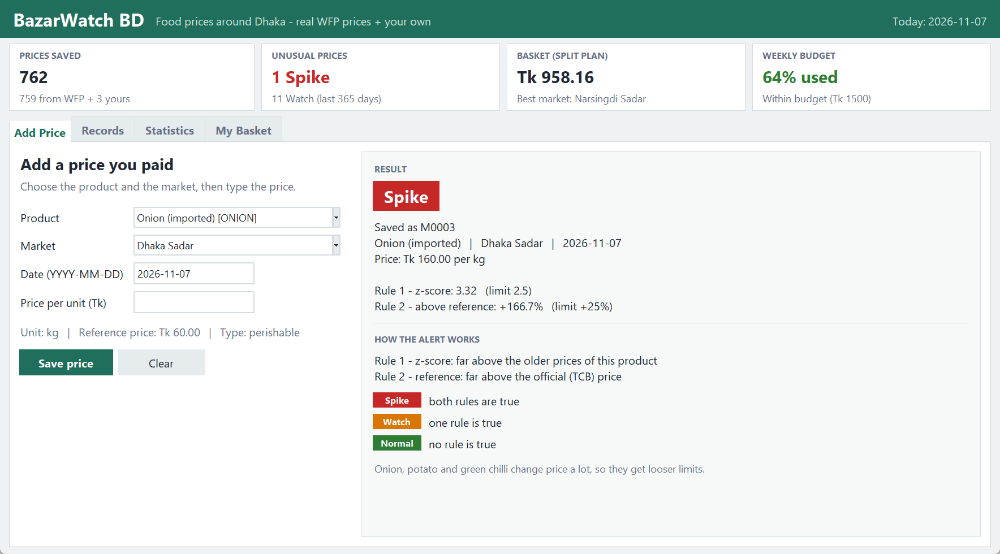
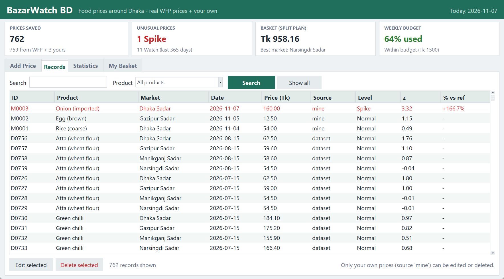
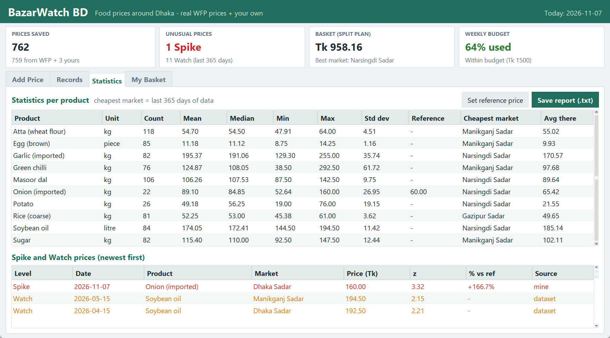
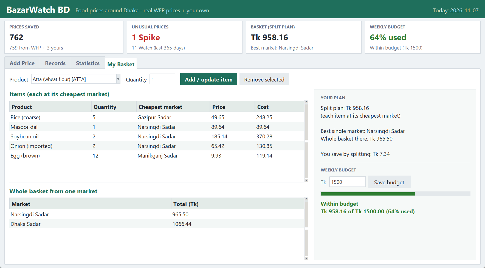

# BazarWatch BD - Food Price Tracker

CSC 4162 Programming in Python - Mid-term Project Report (Fall 2026-27)

> Draft. Fill in the parts marked **[fill in]** before you submit.

---

## 1. Project title and group information

**Project title:** BazarWatch BD - a food price tracker for families around Dhaka

**Application type:** Hybrid application (Tkinter GUI + file records + NumPy analysis)

| Name | Student ID | Main work |
|------|------------|-----------|
| [fill in] | [fill in] | [fill in] |
| [fill in] | [fill in] | [fill in] |
| [fill in] | [fill in] | [fill in] |

**Section:** [fill in] &nbsp;&nbsp; **Course teacher:** [fill in] &nbsp;&nbsp; **Submission date:** [fill in]

---

## 2. Problem statement, objectives and intended users

### Problem

Food prices in Bangladesh change often. Onion, chilli and potato can double in
a few weeks. When a family goes to the bazar they usually do not know whether
today's price is normal or too high, or whether a nearby market is cheaper.
Most people keep no record of what they paid, so they cannot compare.

### Objectives

1. Let the user record the price they paid for a product at a market on a date.
2. Compare each price with real past prices and with an official reference
   price, and mark it **Normal**, **Watch** or **Spike**.
3. Show simple statistics per product (average, median, min, max, standard deviation).
4. Find the cheapest market for each product.
5. Plan a weekly shopping basket and check it against a budget.
6. Save everything in files so the data stays after the app is closed.

### Intended users

- Families and students (mess / hostel) who shop in Dhaka, Gazipur,
  Narsingdi and Manikganj.
- Anyone who wants to keep a small record of bazar prices.

The app stores **no personal information** - only product names, market names,
dates and prices.

---

## 3. Feature list and application workflow / design

### Features

| # | Feature | Where |
|---|---------|-------|
| 1 | Add a price (product, market, date, price) | Add Price tab |
| 2 | Instant alert: Normal / Watch / Spike with z-score and % over reference | Add Price tab |
| 3 | View all records, search by text, filter by product | Records tab |
| 4 | Edit and delete your own prices (dataset prices are read only) | Records tab |
| 5 | Statistics per product with NumPy | Statistics tab |
| 6 | Cheapest market for each product (last 365 days of data) | Statistics tab |
| 7 | List of all Watch and Spike prices | Statistics tab |
| 8 | Set or remove an official reference price | Statistics tab |
| 9 | Save a text report | Statistics tab |
| 10 | Shopping basket: cost at each market, split plan, saving | My Basket tab |
| 11 | Weekly budget with status (Within / Close to / Over budget) and a coloured progress bar | My Basket tab |
| 12 | Summary cards: number of prices, Spike count, basket total, budget used | top of the window |

### Design (layers)

```text
main.py
  └── gui.py (BazarApp)            what the user sees: tabs, forms, tables, messages
        ├── theme.py               colours, fonts and button styles
        └── manager.py (BazarManager)   does each operation the user asks for
              ├── validators.py      checks input, our own error classes
              ├── analytics.py       calculations with NumPy
              ├── models.py          Product, PerishableProduct, PriceRecord
              └── file_handler.py    reads and writes the files in data/
```

The GUI never touches files or does calculations. Each part has one job, so it
is easy to test and easy to explain.

### Workflow: what happens when the user clicks "Save price"

1. `gui.save_price()` reads the form and calls `manager.add_price(...)`.
2. The manager checks the product, the market (`validate_choice`), the date
   (`validate_date`) and the price (`validate_price`).
3. It checks that the same product, market and date was not added before
   (`check_duplicate`, using a set).
4. It makes a `PriceRecord`, adds it to the list and saves `my_prices.csv`.
5. The GUI asks `manager.alert_for(record)`, which calls
   `analytics.alert_level(...)` and gets back `(level, z, pct)`.
6. The GUI shows the level in colour and refreshes all tabs.
7. If any check fails, a `BazarError` is raised, the GUI shows its message,
   and nothing is saved.

### The alert rule

- **Rule 1 (z-score):** `z = (price - mean of older prices) / std of older prices`.
  Used only if there are at least 5 older prices.
- **Rule 2 (reference):** `percent = (price - reference) / reference * 100`.
- Both rules true -> **Spike**, one -> **Watch**, none -> **Normal**.
- Limits: normal products z >= 2.0 and +15%; perishable products
  (onion, potato, green chilli) z >= 2.5 and +25%.

---

## 4. Python concepts used

| Concept | Example in our code |
|---------|---------------------|
| Variables and data types | `str` IDs and dates, `float` prices, `bool` from `is_perishable()`, `None` for "no reference price" |
| Operators | `/`, `*`, `-` in the z-score and percent; `>=`, `<=` for limits; `and` / `or` in the alert rule; `&` for set intersection |
| Conditionals (`if / elif / else`) | `alert_level()` picks Spike / Watch / Normal; `budget_status()` picks Within / Close / Over |
| Loops | `for` over records in `get_history()`, `search()`, `load_prices()`; `enumerate` for CSV line numbers |
| Functions | small functions in `validators.py`, `analytics.py`, `file_handler.py` (each does one task) |
| Comprehensions | `[r for r in records if r.date > start]` in `recent_records()` |
| f-strings | messages and the report, e.g. `f"Tk {price:.2f}"` |
| Default and optional parameters | `source="mine"` in `PriceRecord`, `days=RECENT_DAYS` in `recent_records()` |
| Modules | the code is split into 9 files that import each other |

---

## 5. Data structures: list, tuple, set and dictionary

| Type | Where | Why |
|------|-------|-----|
| **list** | `manager.dataset_records`, `manager.my_records` | an ordered group of `PriceRecord` objects that grows and shrinks |
| **list** | `problems` in `file_handler.py` | collects every file problem to show the user at the end |
| **tuple** | `config.MARKETS`, `UNITS`, `CATEGORIES`, `CSV_HEADER` | fixed values that must not change while the app runs |
| **tuple** | `PriceRecord.key()` returns `(product_id, market, date)` | a tuple can be put in a set, a list cannot |
| **tuple** | `alert_level()` returns `(level, z, pct)` | returns several values at once |
| **set** | `seen_ids` in `load_prices()` | finds a duplicate record ID in a CSV file |
| **set** | `used_keys` in `check_duplicate()` | stops the same price being added twice |
| **set** | `common_markets` in `basket_plan()` | intersection (`&`) = markets that sell every basket item |
| **dict** | `manager.products` = `{product_id: Product}` | find a product by its ID quickly |
| **dict** | `basket = {"budget": 1500, "items": {"RICE": 5, ...}}` | maps each product to a quantity, saved as JSON |
| **dict** | `market_averages()` returns `{market: average}` | average price per market |
| **dict** | `all_alerts()` returns `{record_id: (level, z, pct)}` | alert for each record |
| **dict** | `alert_counts()` returns `{"Normal": ..., "Watch": ..., "Spike": ...}` | counts for the summary card, made from the tuple `ALERT_LEVELS` |

---

## 6. Object-oriented design

| Class | File | Attributes | Main methods |
|-------|------|------------|--------------|
| `Product` | models.py | `product_id`, `name`, `unit`, `category`, `reference_price` | `is_perishable()`, `spike_limits()`, `percent_over_reference()`, `label()`, `to_dict()` |
| `PerishableProduct(Product)` | models.py | same as Product | overrides `is_perishable()` and `spike_limits()` |
| `PriceRecord` | models.py | `record_id`, `product_id`, `market`, `date`, `price`, `source` | `key()`, `can_change()`, `to_row()` |
| `BazarManager` | manager.py | `products`, `dataset_records`, `my_records`, `basket`, `problems` | `add_price()`, `update_price()`, `delete_price()`, `search()`, `statistics()`, `basket_plan()`, `build_report()`, `save_report()` |
| `BazarApp(tk.Tk)` | gui.py | `manager`, the four tabs and their widgets | `save_price()`, `refresh_records()`, `edit_record()`, `delete_record()`, `refresh_stats()`, `refresh_basket()` |
| `EditDialog(tk.Toplevel)` | gui.py | `app`, `record`, the input boxes | `save()` |
| `SummaryCard(tk.Frame)` | gui.py | `value`, `note` (two labels) | `show(value, note, colour)` |
| `BazarError(Exception)` and 3 children | validators.py | message | used with `raise` and `except` |

OOP ideas we used:

- **Inheritance:** `PerishableProduct` is a `Product`. `BazarApp` is a `tk.Tk`.
  Our error classes inherit from `BazarError`.
- **Method overriding / polymorphism:** `spike_limits()` gives different limits
  for perishable products. `alert_level()` just calls `product.spike_limits()`
  and does not need an `if` to check the type.
- **Encapsulation:** the GUI only talks to `BazarManager`; it never opens files.
- **Objects from files:** `product_from_dict()` builds the right class from
  `products.json`.

---

## 7. File handling and exception handling

### Files

| File | Format | What it holds | Read / written by |
|------|--------|---------------|-------------------|
| `data/products.json` | JSON | 10 products and their reference prices | `load_products()`, `save_products()` |
| `data/dataset_prices.csv` | CSV | 759 real WFP prices (read only) | `load_prices()` |
| `data/my_prices.csv` | CSV | prices the user adds | `load_prices()`, `save_prices()` |
| `data/basket.json` | JSON | basket items and weekly budget | `load_basket()`, `save_basket()` |
| `reports/report_YYYY-MM-DD.txt` | TXT | the saved report | `save_report()` |

All files are loaded when the app starts (`BazarManager.load_all()`), and saved
again after every change, so the data stays after the app is closed.
Files are always opened with `with open(...)`, so they are closed even if
something goes wrong.

### Exception handling

We made our own error classes in `validators.py`:

```text
BazarError
 ├── ValidationError       wrong input
 ├── DuplicateRecordError  the same price added twice
 └── RecordNotFoundError   the product or record does not exist
```

The manager raises them, and the GUI catches `BazarError` and shows the message
in a message box. The app keeps running.

| Case (from the project brief) | How we handle it |
|-------------------------------|------------------|
| Invalid action | Markets and products come from read-only dropdowns; `validate_choice()` still checks the market. Clicking Edit/Delete with nothing selected shows "Please select a record first." |
| Non-numeric input | `to_number()` uses `try: float(text) except ValueError` and raises "Price must be a number." |
| Out-of-range value | price must be > 0 and <= 100000, quantity > 0, budget >= 0, the date cannot be in the future |
| Duplicate identifier | `check_duplicate()` uses a set of `(product, market, date)`; `load_prices()` uses a set of record IDs |
| Record not found | `find_record()` and `get_product()` raise `RecordNotFoundError` |
| File error | missing `my_prices.csv` is created; missing or broken JSON gives an empty start and a warning; bad CSV rows are skipped and the line number is shown; save errors (`OSError`) become a `BazarError` with a clear message |
| Any other unexpected error | `BazarApp.report_callback_exception()` shows it in a message box instead of crashing |

---

## 8. Library / module use and justification

### NumPy (in `analytics.py`)

| NumPy function | What we use it for |
|----------------|--------------------|
| `np.mean`, `np.median`, `np.min`, `np.max` | statistics per product |
| `np.std(prices, ddof=1)` | sample standard deviation for the z-score and the statistics table |
| `np.dot(quantities, prices)` | total cost of the basket at one market (sum of quantity x price) |

NumPy does the number crunching. The decisions (Spike / Watch / Normal,
cheapest market, budget status) are written by us in plain Python, so the
library does not hide our logic.

### Tkinter (in `gui.py` and `theme.py`)

`Notebook` (tabs), `Treeview` (tables with coloured and striped rows),
`Combobox` (dropdowns), `Entry`, `Button`, `Progressbar` (budget used),
`messagebox` (errors and confirmations), `simpledialog` (reference price) and
`Toplevel` (edit window). It gives a simple window that anyone can use without
typing commands.

All colours and fonts are kept in `theme.py`, and `ttk.Style` applies them to
every widget. Green buttons mark the main action of each tab, and the table
rows are coloured by alert level (red = Spike, orange = Watch).

### Standard library

`csv`, `json` (files), `datetime` (dates and the 365-day window),
`pathlib` (file paths that work on any computer), `unittest` (54 tests) and
`ctypes` (in `main.py`, so the text stays sharp on Windows screens with 125% or
150% display scaling).

---

## 9. Screenshots and sample input / output

> Note: in these screenshots the onion reference price was set to Tk 60 as an
> example for the demo. It is not an official TCB price.

**Add Price - an onion price of Tk 160 is marked Spike**



**Records - search, filter, edit and delete**



**Statistics - NumPy statistics, cheapest market and alerts**



**My Basket - split plan, best single market and budget**



### Sample input and output

| Input | Output |
|-------|--------|
| Onion, Dhaka Sadar, today, `160` (reference 60) | **Spike** - z = 3.32, +166.7% vs reference |
| Rice, Dhaka Sadar, `54` | **Normal** - z = 0.49 |
| Price `abc` | "Price must be a number." |
| Price `-5` | "Price must be more than 0." |
| Date `15-06-2026` | "Date must be in YYYY-MM-DD format." |
| A date in the future | "Date cannot be in the future." |
| The same product, market and date again | "You already added a price for this product at this market on this date." |
| Edit a dataset price | "Dataset prices cannot be edited. You can only edit your own prices." |
| Basket: rice 5, dal 1, oil 2, onion 2, egg 12, budget 1500 | Split plan Tk 958.16, best single market Narsingdi Sadar Tk 965.50, Within budget (64% used) |

### Saved report (part of `screenshots/sample_report.txt`)

```text
BazarWatch BD - Price Report
============================================================
Made on      : 2026-11-07
Dataset      : 759 prices from WFP
My prices    : 3
Recent window: last 365 days up to 2026-11-07

PRODUCT SUMMARY
------------------------------------------------------------
...
Onion (imported) - per kg
   average Tk 89.10, min Tk 52.64, max Tk 160.00, latest Tk 160.00
   cheapest market: Narsingdi Sadar (Tk 65.42)
...

SPIKE AND WATCH PRICES (recent window)
------------------------------------------------------------
...
Spike  2026-11-07 Onion (imported)       Dhaka Sadar      Tk 160.00 (z=3.32, +166.7% vs reference)

MY BASKET
------------------------------------------------------------
Split plan total: Tk 958.16
Best single market: Narsingdi Sadar (Tk 965.50)
Budget: Within budget - Tk 958.16 of Tk 1500.00 (64% used)
```

---

## 10. Limitations, societal benefit and future improvements

### Limitations

- Only 4 markets and 10 products.
- WFP collects prices about once a month, and the newest price is from
  August 2026. So "recent" means the last 365 days before the newest price.
- Onion and potato have few WFP prices (21 and 26), so their z-score is less reliable.
- The official TCB reference price has to be typed in by the user.
- It is a single-user desktop app; the data stays on one computer.

### Societal benefit

- Families can see at once if they are paying too much.
- The cheapest-market and split plan show where to buy to save money.
- The budget check helps students and low-income families plan their week.
- It uses open, real data from the World Food Programme, and it keeps no
  personal information.

### Future improvements

- Download the newest WFP prices automatically.
- Add more markets and products, and a Bangla interface.
- Show a price chart for each product.
- Keep a history of weekly baskets to see how spending changes.
- Let a group of users share their prices (for example a whole mess or a neighbourhood).

---

**Data source:** World Food Programme (WFP), Bangladesh - Food Prices, via the
Humanitarian Data Exchange (HDX), licence CC BY-IGO.
https://data.humdata.org/dataset/wfp-food-prices-for-bangladesh
