# Shasroi Bazar

**A desktop app that helps a family in the Dhaka area track food prices, spot price spikes and plan a weekly shopping basket.**


You write down what you paid at the bazar. The app tells you whether the price is **Normal**, worth a **Watch**, or a **Spike**, which market is cheapest, and whether your weekly shopping fits your budget.

Made for the **CSC 4162 Programming in Python** mid-term project.

---

## Contents

- [Screenshots](#screenshots)
- [Features](#features)
- [How it works](#how-it-works)
  - [Architecture](#architecture)
  - [Class design](#class-design)
  - [Saving a price, step by step](#saving-a-price-step-by-step)
  - [Price alert rules](#price-alert-rules)
  - [Basket plan](#basket-plan)
  - [Dataset pipeline](#dataset-pipeline)
- [Data files](#data-files)
- [Project structure](#project-structure)
- [Getting started](#getting-started)
- [Quick demo](#quick-demo)
- [Tests](#tests)
- [Error handling](#error-handling)
- [Libraries and tools](#libraries-and-tools)
- [Data source](#data-source)

---

## Screenshots

| Add Price | Records |
|:---:|:---:|
| 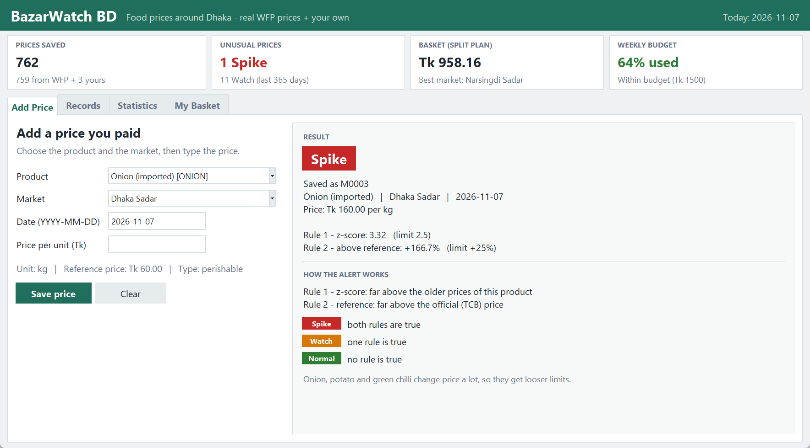 | 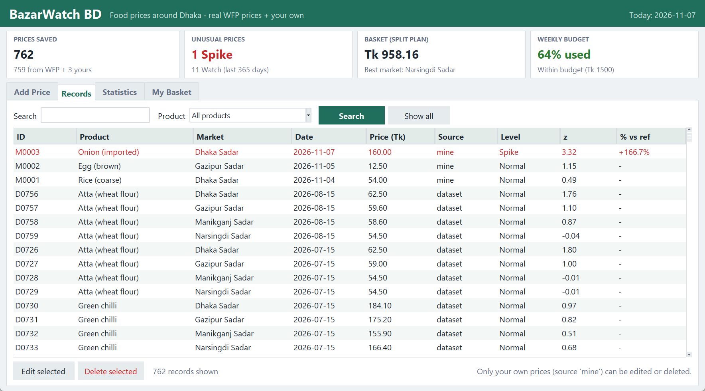 |
| **Statistics** | **My Basket** |
| 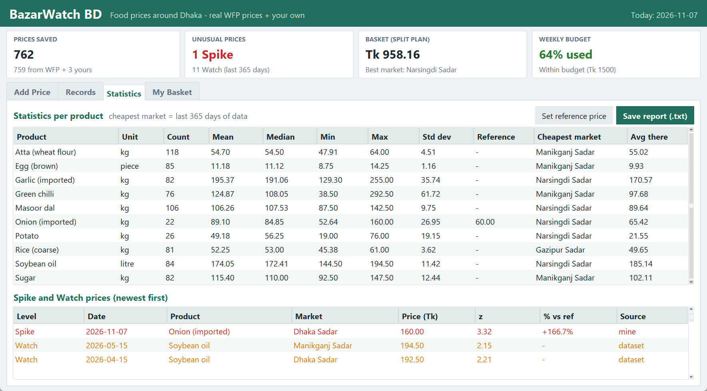 | 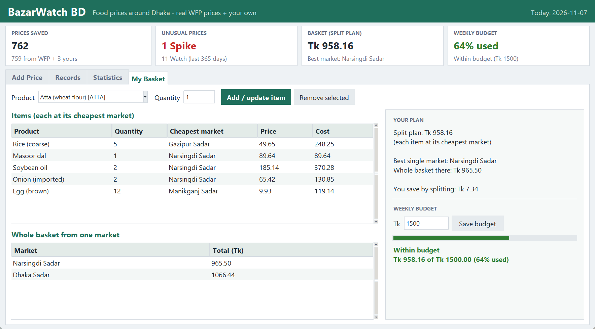 |

---

## Features

The app has four tabs:

| Tab | What you can do |
|-----|-----------------|
| **Add Price** | Add a price you paid. The app checks it right away and shows **Normal**, **Watch** or **Spike**. |
| **Records** | See all prices, search by product, market, date or ID, filter by product, and edit or delete your own prices. |
| **Statistics** | See count, mean, median, min, max and standard deviation for each product, the cheapest market and every Watch or Spike price. Set a reference price and save a `.txt` report. |
| **My Basket** | Make a shopping list and see what it costs at each market, the cheapest "split" plan and your budget status. |

Four **summary cards** at the top always show how many prices you have, how many are Spike, what your basket costs and how much of your budget it uses.

The app mixes two kinds of prices:

- **Real prices** from the World Food Programme (WFP) for 4 markets near Dhaka, January 2024 to August 2026 (759 records). These are read only.
- **Your own prices**, which you can add, edit and delete.

Everything is saved to files, so nothing is lost when you close the app.

**Products tracked:** rice, atta, masoor dal, soybean oil, sugar, onion, potato, garlic, green chilli and eggs.
**Markets:** Dhaka Sadar, Gazipur Sadar, Narsingdi Sadar and Manikganj Sadar.

---

## How it works

### Architecture

The app is split into layers. The window never reads files or does calculations itself. It only talks to `BazarManager`, and the manager uses the other modules to do the work.

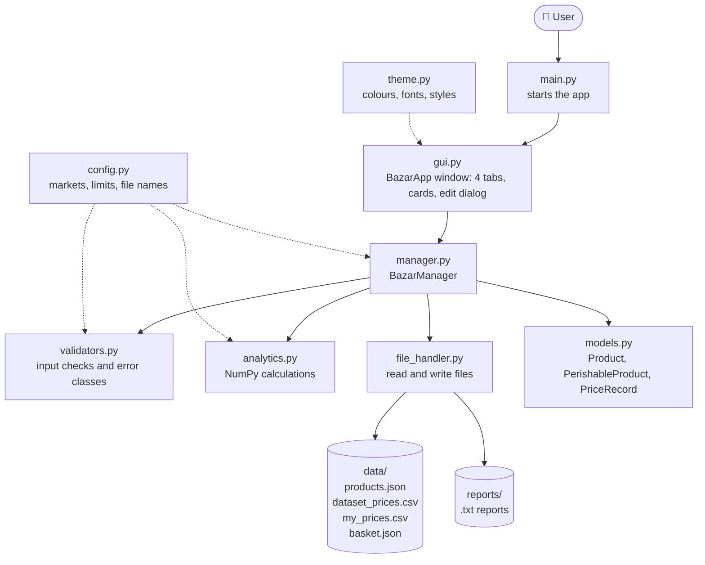

| Module | Job |
|--------|-----|
| `main.py` | Starts the app and makes text sharp on Windows screens with display scaling |
| `gui.py` | The Tkinter window: header, summary cards, 4 tabs and the edit dialog |
| `theme.py` | Colours, fonts, button and table styles |
| `manager.py` | `BazarManager`: connects the window, the files and the calculations |
| `models.py` | The classes `Product`, `PerishableProduct` and `PriceRecord` |
| `analytics.py` | Alerts, statistics, cheapest market and basket plan, using NumPy |
| `validators.py` | Input checks and the app's own error classes |
| `file_handler.py` | Reads and writes JSON, CSV and TXT files |
| `config.py` | Fixed values: file names, markets, alert limits, input limits |
| `prepare_dataset.py` | Builds `data/dataset_prices.csv` from the raw WFP file |

### Class design

`PerishableProduct` inherits from `Product` and overrides `spike_limits()`, so perishable food gets looser alert limits. All the app's errors inherit from `BazarError`, so the window can catch them in one place.

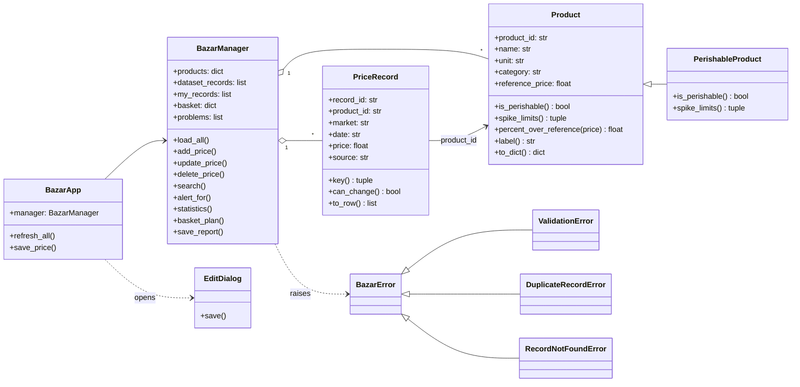

### Saving a price, step by step

What happens when you click **Save price** in the Add Price tab:

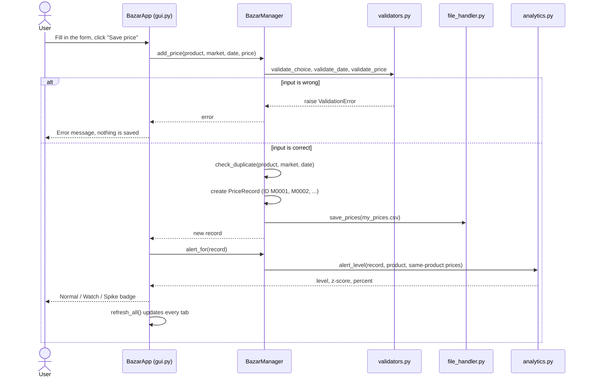

### Price alert rules

Every price is checked with two simple rules:

1. **z-score rule:** is the price far above the older prices of the same product?
   `z = (price - mean of older prices) / standard deviation`
   It is only used when there are at least **5** older prices.
2. **Reference rule:** is the price far above the official (TCB) reference price?
   `percent = (price - reference) / reference × 100`

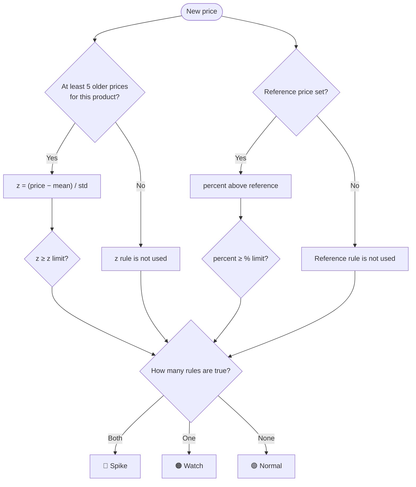

Perishable products change price a lot, so they get looser limits:

| Product type | Products | z limit | % limit |
|--------------|----------|:-------:|:-------:|
| Normal | rice, atta, dal, oil, sugar, garlic, egg | z ≥ 2.0 | +15% |
| Perishable | onion, potato, green chilli | z ≥ 2.5 | +25% |

All limits live in `config.py`.

### Basket plan

The **My Basket** tab uses the average price of each product at each market from the last 365 days.

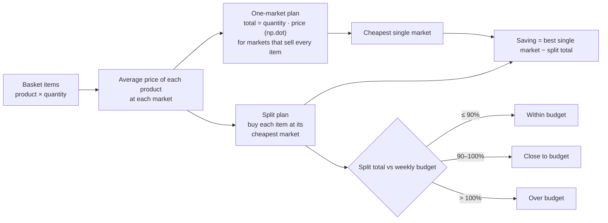

"Recent" means the last 365 days counted back from the **newest price in the data**, not from today, because the WFP data stops in August 2026.

### Dataset pipeline

The raw WFP file has about 34,000 rows for the whole country. `prepare_dataset.py` keeps only the rows the app needs.

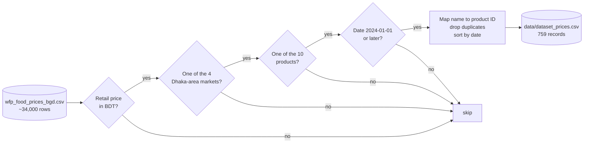

The prepared file is already in the repo, so you **don't** need to run this. To rebuild it:

1. Download `wfp_food_prices_bgd.csv` from the [HDX page](https://data.humdata.org/dataset/wfp-food-prices-for-bangladesh).
2. Put it in `Shasroi_Bazar/data/raw/`.
3. Run `python prepare_dataset.py` from the `Shasroi_Bazar` folder.

---

## Data files

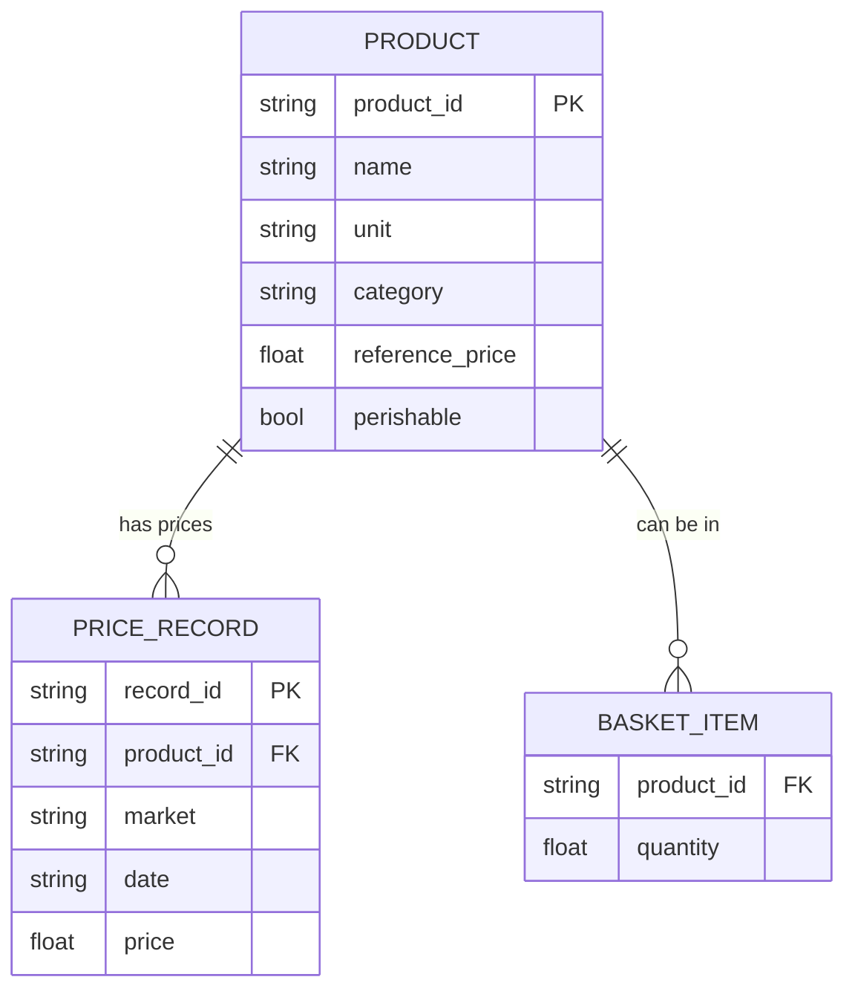

| File | Format | What it holds |
|------|--------|---------------|
| `data/products.json` | JSON | 10 products with unit, category, reference price and perishable flag |
| `data/dataset_prices.csv` | CSV | 759 real WFP prices (read only, IDs `D0001`…) |
| `data/my_prices.csv` | CSV | Prices you add in the app (IDs `M0001`…) |
| `data/basket.json` | JSON | Your basket items and weekly budget |
| `reports/*.txt` | TXT | Price reports saved from the Statistics tab |

---

## Project structure

```text
Shasroi_Bazar/                       (repository root)
├── README.md
├── Python_Midterm_Project_Requirements_Fall_26_27.pdf
├── Submission/
│   ├── Shasroi_Bazar_Project_Report.pdf
│   ├── Shasroi_Bazar_Project_Report.docx
│   └── Shasroi_Bazar_Presentation.pptx
└── Shasroi_Bazar/                   (the app)
    ├── main.py
    ├── gui.py
    ├── theme.py
    ├── manager.py
    ├── models.py
    ├── analytics.py
    ├── validators.py
    ├── file_handler.py
    ├── config.py
    ├── prepare_dataset.py
    ├── requirements.txt
    ├── data/
    │   ├── products.json
    │   ├── dataset_prices.csv
    │   ├── my_prices.csv
    │   └── basket.json
    ├── docs/
    │   ├── REPORT.md
    │   └── screenshots/
    └── tests/
        ├── helpers.py
        ├── test_models.py
        ├── test_validators.py
        ├── test_analytics.py
        ├── test_manager.py
        └── test_gui.py
```

---

## Getting started

**Requirements:** Python 3.10 or newer. Tkinter comes with Python on Windows and macOS. On Ubuntu you may need `sudo apt install python3-tk`.

```bash
git clone https://github.com/sumaiya-akter-roshni/Shasroi_Bazar.git
cd Shasroi_Bazar/Shasroi_Bazar
pip install -r requirements.txt
python main.py
```

---

## Quick demo

1. Open **Statistics**, click **Onion (imported)**, then **Set reference price** and type `60`.
2. Go to **Add Price**, choose Onion, Dhaka Sadar, today's date and price `160`, then click **Save price**. The app shows a red **Spike**.
3. Try a wrong price like `abc` or `-5`. You get a clear message and the app keeps running.
4. Close the app and open it again. Your price is still in **Records** (saved in `data/my_prices.csv`).
5. In **My Basket**, change a quantity or the budget and watch the totals change.
6. Click **Save report (.txt)** in Statistics. The report goes to the `reports/` folder.

---

## Tests

54 unit tests cover the models, validators, calculations, manager and window.

```bash
cd Shasroi_Bazar
python -m unittest -v
```

| Test file | Tests | What it checks |
|-----------|:-----:|----------------|
| `test_models.py` | 6 | Product classes, perishable limits, JSON round trip, price records |
| `test_validators.py` | 9 | Price, date, quantity, budget and market checks, error classes |
| `test_analytics.py` | 15 | Alert levels, statistics, recent prices, cheapest market, basket plan, budget |
| `test_manager.py` | 19 | Loading files, add, edit, delete, duplicates, search, alerts, basket, report |
| `test_gui.py` | 5 | Records table, saving a price, error messages, summary cards, budget status |

The tests use a temporary copy of the data, so your real files are never changed. The window tests are skipped on a computer without a screen.

---

## Error handling

| Problem | What the app does |
|---------|-------------------|
| Empty box, text instead of a number, negative price, future date | Shows a clear message and saves nothing |
| The same product, market and date entered twice | `DuplicateRecordError`, nothing is saved |
| Missing `my_prices.csv` | Created empty on the first run |
| Bad row in a CSV file | Row is skipped and the app says which line was wrong |
| Broken `products.json` or `basket.json` | The app still opens and shows a warning |
| A file cannot be saved | The `OSError` becomes a `BazarError` with a clear message |
| Any other unexpected error | Shown in a message box, and the app keeps running |

---

## Libraries and tools

| Library | Type | Used for |
|---------|------|----------|
| `numpy` | External | Mean, median, min, max, standard deviation, z-score and basket totals |
| `tkinter` | Standard | The desktop window, tabs, tables and dialogs |
| `json` | Standard | `products.json` and `basket.json` |
| `csv` | Standard | Price files |
| `pathlib` | Standard | File and folder paths |
| `datetime` | Standard | Date checks and the 365-day "recent" window |
| `ctypes` | Standard | Sharp text on Windows screens with display scaling |
| `sys` | Standard | Command-line argument in `prepare_dataset.py` |
| `unittest` | Standard | Unit tests |
| `tempfile` | Standard | Temporary data folders in the tests |

**Tools:** Python 3.10+, pip, Git and GitHub.

---

## Data source

Price data: **World Food Programme (WFP) - Bangladesh Food Prices**, from the Humanitarian Data Exchange (HDX), licence **CC BY-IGO**.
<https://data.humdata.org/dataset/wfp-food-prices-for-bangladesh>
